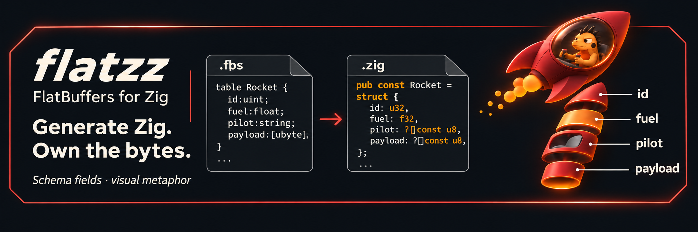
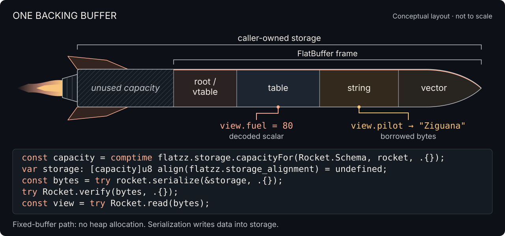
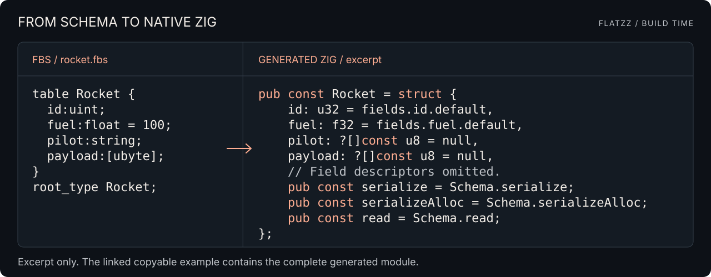

# Flatzz

<p align="center">
  
</p>

<p align="center">
  <a href="build.zig"></a>
  <a href="src/runtime.zig"></a>
  <a href="example/readme/main.zig"></a>
</p>

Generate Zig from FlatBuffers schemas. Serialize native values. Borrow views
from existing bytes.

<p align="center">
  <a href="#1-serialize-and-read-back">Quick start</a> ·
  <a href="docs/examples.md">Copyable examples</a> ·
  <a href="src/runtime.zig">Runtime API</a> ·
  <a href="src/compiler.zig">Compiler API</a> ·
  <a href="example/README.md">More examples</a>
</p>

## 1. Serialize and read back

Run from this checkout with **Zig 0.17.0**:

```sh
zig build run-readme
```

The build generates a `rocket` module from [rocket.fbs](example/readme/rocket.fbs).
Inside a function with `std` imported, an `allocator`, and the generated `Rocket` type:

```zig
const rocket: Rocket = .{
    .id = 7,
    .fuel = 80,
    .pilot = "Ziguana",
    .payload = &.{ 1, 2, 3 },
};
const result = try rocket.serializeAlloc(allocator, .{});
defer result.deinit(allocator);

try Rocket.verify(result.bytes, .{});
const view = try Rocket.read(result.bytes);
try std.testing.expectEqual(@as(u32, 7), view.id);
try std.testing.expectEqual(@as(f32, 80), view.fuel);
try std.testing.expectEqualStrings("Ziguana", view.pilot.?);
```

[Copy complete test](docs/examples.md#1-serialize-and-read-back) ·
[Complete runner](docs/examples.md#complete-runner) ·
[Runnable source and tests](example/readme/main.zig)

`result` owns the allocation. Release it once with the same allocator and keep
it alive while using borrowed views. `view.fuel` is the decoded scalar `80`;
`view.pilot` borrows the string `"Ziguana"` from `result.bytes`.

## 2. Use caller-owned storage

[](docs/examples.md#2-use-caller-owned-storage)

[Copy code](docs/examples.md#2-use-caller-owned-storage) ·
[Runnable source and tests](example/readme/main.zig)

`rocket.serialize(&storage, .{})` writes into an aligned caller-owned buffer
without heap allocation. The returned bytes borrow part of that storage;
reusing it invalidates the frame and its views. Serialization writes data into
the frame. The illustration is conceptual, not an exact byte layout.

## 3. From FBS to generated Zig

[](docs/examples.md#3-from-fbs-to-generated-zig)

[Copy schema and full generated source](docs/examples.md#3-from-fbs-to-generated-zig) ·
[Schema](example/readme/rocket.fbs) · [Runnable source](example/readme/main.zig)

Generation happens on the host at build time. The application imports the
generated module and the Flatzz runtime. The illustration omits field metadata;
the [copyable example](docs/examples.md#3-from-fbs-to-generated-zig) includes the
complete generated output. Rocket stages in the banner represent schema fields,
not physical offsets in the frame.

## 4. Read and edit existing bytes

| Operation | Purpose |
| --- | --- |
| `verify` | Traverse known schema fields and validate their reachable wire data |
| `read` | Decode scalars and borrow strings and structured views |
| `update` | Replace a present scalar, string, struct, or vector without growing the frame |
| `borrowMutable` | Borrow a structured field; inline structs retain mutable access |

[Copy read/edit test](docs/examples.md#4-read-and-edit-existing-bytes) ·
[Mutable nested struct example](example/generated/main.zig) ·
[More examples](example/README.md)

`update` returns `false` when a field is absent. Strings and vectors must keep
their lengths; replacing tables or whole unions requires rebuilding. Read scalars
again after an edit. Borrowed strings still refer to the same bytes, so edits can
also be visible through earlier views.

For mapped input, the application supplies the byte slice and manages the mapping
and buffer lifetime. Use explicit Builder handles when child tables must be shared;
see the [Builder example](example/builder/main.zig).

## Build and development

<details>
<summary>Build commands and compatibility</summary>

Run from this directory. Zig fetches the pinned Zast package for schema tooling.
The runtime, parser, reflection model, and BFBS APIs can be checked without Zast.
The default `check` and `test` steps generate the README example.

| Command | Action |
| --- | --- |
| `zig build` | Install the compiler, both examples, and generated Reading |
| `zig build compiler` | Build and install only `zig-out/bin/flatzz` |
| `zig build run-readme` | Generate Rocket; allocate, serialize, receive, read, and edit |
| `zig build run-mission` | Generate Mission from two FBS files; serialize with comptime-sized storage and read it |
| `zig build run-monster` | Generate Monster; serialize with comptime-sized storage and read its fields and union |
| `zig build run` | Generate Reading; serialize with buffers sized at comptime |
| `zig build run-builder` | Run construction, mutation, and unions with Builder |
| `zig build check` | Compile examples, tests, and contracts |
| `zig build test` | Test native runtime, FBS parsing, generated Zig, and contracts |
| `zig build fmt` | Check Zig formatting |
| `zig build docs` | Generate runtime API docs in `zig-out/docs` |
| `zig build check test -Dschema-tools=false` | Check and test runtime/compiler APIs without Zast |
| `zig build generate-reading` | Regenerate `tests/fixtures/reading/reading.zig` |
| `zig build --help` | List targets and options |

The generated example executable is `zig-out/bin/flatzz-example`.

All example commands and independent example builds: [example/README.md](example/README.md).

</details>

<details>
<summary>Implementation layout and ownership</summary>

The public entry points are [runtime.zig](src/runtime.zig) (`flatzz`) and
[compiler.zig](src/compiler.zig) (`flatzz_compiler`). Applications can use the
runtime, FBS parser, reflection model, and BFBS codec without Zast. Zig source
generation uses a separate host backend; generated modules import only `flatzz`.

| Responsibility | Implementation |
| --- | --- |
| Descriptors, schema composition, and public adapters | [schema.zig](src/runtime/schema.zig) |
| Native graph preflight and packing | [native_graph.zig](src/runtime/schema/native_graph.zig) |
| Checked local buffer access, ranges, and scalar reads/writes | [buffer_access.zig](src/runtime/buffer_access.zig) |
| Result types and field reads from checked tables | [field_access.zig](src/runtime/schema/field_access.zig) |
| Storage bounds, native sizing, and owned serialized buffers | [storage.zig](src/runtime/storage.zig) |
| Buffer construction and table state | [Builder.zig](src/runtime/Builder.zig), [table_builder.zig](src/runtime/table_builder.zig) |
| Known-schema wire traversal and resource limits | [Verifier.zig](src/runtime/Verifier.zig) |
| Public FBS API, diagnostics, and options | [parser.zig](src/compiler/parser.zig) |
| Compiler and parser tests | [test_compiler.zig](tests/test_compiler.zig), [test_parser.zig](tests/test_parser.zig) |
| Sources, symbols, semantic resolution, defaults, and layout | [Compilation.zig](src/compiler/fbs/Compilation.zig) |
| Source cursor and declaration grammar | [Parser.zig](src/compiler/fbs/Parser.zig) |
| Shared unresolved declarations and spelling helpers | [model.zig](src/compiler/fbs/model.zig) |
| Reflection records and primitive facts | [reflection.zig](src/compiler/reflection.zig) |
| Public BFBS API, encoding, decoding, and shared record layout | [bfbs.zig](src/compiler/bfbs.zig), [Encoder.zig](src/compiler/bfbs/Encoder.zig), [Decoder.zig](src/compiler/bfbs/Decoder.zig), [record_layout.zig](src/compiler/bfbs/record_layout.zig) |
| Source generation lifetime, lowering, and scratch expression construction | [codegen.zig](src/compiler/codegen.zig), [Generator.zig](src/compiler/codegen/Generator.zig), [Syntax.zig](src/compiler/codegen/Syntax.zig) |

[Detailed ownership and implementation notes](docs/examples.md#ownership-and-implementation-notes).

</details>
